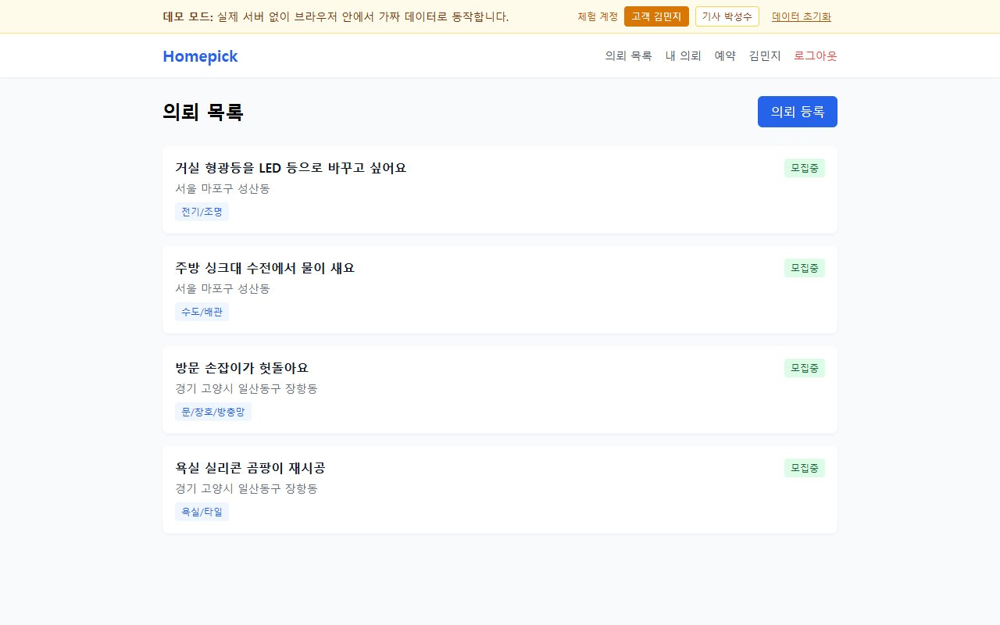
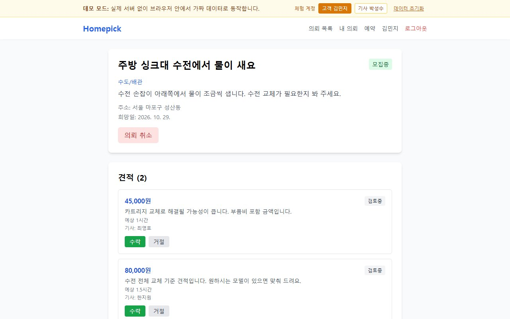

# Homepick (홈픽) — 소액 집수리 중개

> 🔗 **Live Demo**: https://homepick-seven.vercel.app

수도꼭지 교체나 방문 손잡이 수리처럼 작은 집수리를 올리면, 여러 수리 기사가 견적을 내고 고객이 골라서 맡기는 웹 서비스입니다.

**바로 써 보기: https://yeomhojun1.github.io/homepick/**

## 이게 뭔가요

동네 게시판에 "주방 수전에서 물이 새요"라고 붙여 두면 기사님들이 "4만 5천 원에 고쳐 드릴게요"라고 쪽지를 남기고, 그중 마음에 드는 분께 연락하는 과정을 웹 화면으로 옮긴 것입니다.
고객은 수리할 내용을 올리고, 기사는 금액과 설명을 적어 견적을 내고, 고객이 견적을 비교해 한 명을 고르면 예약이 잡힙니다. 작업이 끝나면 서로 별점과 후기를 남깁니다.

## 이런 분께 필요해요

- **수전에서 물이 새는데 큰 업체는 소액 수리를 잘 받아 주지 않을 때.** 업체마다 전화를 돌리는 대신 한 번 올려 두고 견적이 들어오기를 기다릴 수 있습니다.
- **형광등을 LED로 바꾸고 싶은데 적정 가격을 모를 때.** 여러 기사의 금액, 예상 작업 시간, 설명을 한 화면에서 나란히 보고 고를 수 있습니다.
- **작은 일감을 찾는 수리 기사.** 일감마다 비용을 먼저 내지 않고, 올라온 의뢰 목록을 보고 할 수 있는 일에 바로 견적을 낼 수 있습니다.

## 화면으로 보기



고객으로 들어갔을 때의 첫 화면입니다. 기사를 기다리는 의뢰가 "모집중" 표시와 함께 보이고, 각 의뢰에는 지역과 수리 종류(전기/조명, 수도/배관 등)가 붙어 있습니다. 맨 위 노란 띠는 데모 전용으로, 고객과 기사 화면을 버튼 하나로 바꿀 수 있게 해 줍니다.



의뢰 하나를 열었을 때의 화면입니다. 두 기사가 낸 견적(45,000원과 80,000원)이 금액, 설명, 예상 시간과 함께 나란히 나오고, 고객은 원하는 견적에 [수락] 또는 [거절]을 누릅니다.

## 바로 써 보기

**https://yeomhojun1.github.io/homepick/**

- 설치나 회원가입 없이 링크만 열면 됩니다. 처음 들어가면 고객 계정으로 자동 로그인되어 있습니다.
- 이 데모는 실제 서버 없이 **브라우저 안에서 가짜 데이터로** 동작합니다. 입력한 내용은 내 브라우저에만 남고 다른 사람에게 보이지 않습니다. 맨 위 [데이터 초기화]를 누르면 처음 상태로 돌아갑니다.
- 로그인 화면이 나오면 아래 계정을 쓰면 됩니다.

| 역할 | 이메일 | 비밀번호 |
|---|---|---|
| 고객 (김민지) | `customer@demo.homepick` | `demo1234` |
| 기사 (박성수) | `worker@demo.homepick` | `demo1234` |

### 체험 순서

맨 위 노란 띠의 **[고객 김민지] / [기사 박성수]** 버튼으로 역할을 바꿔 가며 진행합니다.

1. **고객으로 의뢰 올리기** — [의뢰 목록]에서 [의뢰 등록]을 누르고 수리 종류, 제목, 상세 설명(10자 이상), 주소를 적은 뒤 [등록]을 누릅니다. 희망 날짜는 비워도 됩니다.
2. **기사로 견적 내기** — [기사 박성수]로 바꾼 뒤 [의뢰 목록]에서 방금 올린 의뢰를 엽니다. [견적 제출]을 누르고 금액과 메시지(예상 시간은 선택)를 적어 [제출]합니다.
3. **고객으로 수락하기** — [고객 김민지]로 바꾸고 같은 의뢰를 엽니다([내 의뢰] 메뉴에서도 찾을 수 있습니다). 받은 견적에서 [수락]을 누르면 의뢰가 "예약완료"로 바뀌고 예약이 자동으로 만들어집니다.
4. **예약 확인** — [예약] 메뉴에서 방금 잡힌 예약과 담당 기사 이름을 확인합니다.
5. **기사로 완료 처리** — [기사 박성수]로 바꾸고 [예약] 메뉴에서 해당 예약의 [완료 처리]를 누릅니다.
6. **고객으로 리뷰 남기기** — [고객 김민지]로 바꾸고 [예약] 메뉴에서 완료된 예약에 별점과 후기를 적어 [리뷰 등록]을 누릅니다. 기사 쪽에서도 같은 방식으로 고객에게 리뷰를 남길 수 있고, 받은 리뷰는 각자의 프로필 화면(상단 이름 클릭)에 쌓입니다.

## 할 수 있는 것

- **수리 의뢰 올리기** — 수리 종류 8가지(수도/배관, 전기/조명, 도배/벽지, 에어컨, 보일러/난방, 욕실/타일, 문/창호/방충망, 가구/조립) 중 하나를 고르고 내용, 주소, 희망 날짜를 적습니다.
- **올라온 의뢰 둘러보기** — 아직 기사를 기다리는 의뢰만 최신순으로 모아 보여 줍니다.
- **견적 내기 (기사)** — 금액, 설명, 예상 작업 시간을 적어 견적을 냅니다. 같은 의뢰에 두 번 낼 수 없고, 이미 예약이 잡힌 의뢰에는 낼 수 없습니다.
- **견적 비교하고 고르기 (고객)** — 받은 견적을 나란히 보고 하나를 수락하거나 거절합니다. 수락하면 예약이 자동으로 만들어집니다.
- **의뢰 취소 (고객)** — 아직 기사를 고르지 않은 의뢰는 취소할 수 있습니다.
- **작업 완료 처리 (기사)** — 작업을 마친 기사가 예약을 완료로 바꿉니다.
- **서로 리뷰 남기기** — 완료된 예약에 대해 고객과 기사가 서로 별점(1~5)과 후기를 남기고, 프로필에서 받은 리뷰를 볼 수 있습니다.
- **역할에 따른 권한 구분** — 의뢰는 고객만, 견적은 기사만 낼 수 있고, 예약 내용은 그 예약의 고객과 기사만 볼 수 있습니다.

## 어떻게 동작하나요

1. **입력** — 고객이 화면에서 의뢰를 적고 [등록]을 누릅니다.
2. **처리** — 화면은 그 내용을 서버로 보냅니다. 서버는 "고객이 보낸 요청인지", "필수 항목이 다 있는지"를 확인한 뒤 데이터베이스에 저장합니다. 기사가 견적을 내거나 고객이 견적을 수락할 때도 같은 방식으로, 서버가 권한과 상태(이미 예약된 의뢰인지 등)를 확인하고 저장합니다. 견적 수락처럼 여러 기록이 함께 바뀌어야 하는 작업은 한꺼번에 처리해서, 중간에 실패해도 "견적은 수락됐는데 예약은 없는" 상태가 남지 않게 했습니다.
3. **결과** — 화면은 서버에서 최신 목록을 다시 받아 보여 줍니다. 고객은 들어온 견적을, 기사는 자기 예약을 바로 확인할 수 있습니다.

라이브 데모에서는 2번의 서버와 데이터베이스 대신, 브라우저 안에 넣어 둔 가짜 서버가 같은 응답을 흉내 냅니다.

등장 용어 풀이:

- **서버** — 화면 뒤에서 요청을 받아 확인하고 저장하는 프로그램입니다. 가게로 치면 주문을 받아 처리하는 주방입니다.
- **데이터베이스** — 회원, 의뢰, 견적, 예약, 리뷰 기록을 표 형태로 보관하는 저장소입니다.
- **API** — 화면과 서버가 주고받는 약속된 요청 목록입니다(예: "의뢰 목록 주세요", "이 견적 수락합니다"). 이 프로젝트에는 21개가 있습니다.
- **로그인 토큰** — 로그인하면 받는 일종의 출입증입니다. 이후 요청마다 이 출입증을 보여 줘서 서버가 누가 보낸 요청인지 압니다.

## 어떻게 만들었나요

- **AI 코딩 에이전트로 제작** — 유사 서비스 조사([`.claude/research.md`](.claude/research.md))부터 화면과 서버 코드 작성까지 Claude Code(AI 코딩 에이전트)를 써서 진행했습니다.
- **테스트 에이전트로 기능 점검 (2026-09-16)** — 별도 에이전트가 기능 49개를 하나씩 실행해 점검했습니다. 결과는 통과 30, 실패 11, 실행 환경이 없어 확인하지 못함 8이었습니다. 서버 API는 데이터베이스만 가짜로 바꾼 실험 환경에서 73개 상황을 직접 호출해 67개 통과, 6개 실패였습니다. 이 과정에서 문제 14건(B1~B14)을 찾았습니다. 대표적으로 서버가 아예 켜지지 않던 문제 3건, 다른 사람 정보 조회 시 비밀번호 암호값이 응답에 섞여 나가던 문제, 기사도 의뢰를 올리고 고객도 견적을 낼 수 있던 권한 누락, 관계없는 사람이 남의 예약을 볼 수 있던 문제가 있었습니다. ([`feature-test-report.md`](feature-test-report.md))
- **수정과 재검증 (2026-09-17)** — 찾은 문제를 고친 뒤, 0개였던 자동 테스트를 23개 새로 붙여 모두 통과시켰고, 같은 실험 환경에서 15개 항목을 다시 확인해 모두 통과했습니다. 수리 종류 8가지를 미리 넣어 두는 준비 작업도 추가했습니다. 그 전에는 빈 데이터베이스에서 수리 종류를 고를 수 없어 의뢰 등록 자체가 불가능했습니다. ([`fix-report.md`](fix-report.md))
- **데모 모드 추가 (2026-10-26)** — 처음 보는 사람이 설치 없이 써 볼 수 있도록, 서버 없이 브라우저 안에서 가짜 데이터로 돌아가는 데모 모드를 만들어 GitHub Pages에 올렸습니다. 이때 화면에 없던 리뷰 작성과 프로필의 받은 리뷰 목록도 추가했습니다. 같은 날 라이브 데모에서 의뢰 등록 → 견적 제출 → 수락 → 예약 확인 → 완료 처리 → 리뷰 등록 흐름을 자동화 브라우저로 끝까지 실행해 동작을 확인했습니다.

## 아직 부족한 점

- **실제 사용자가 없습니다.** 공개 서비스로 운영한 적이 없는 개인 프로젝트입니다.
- **라이브 데모는 가짜 데이터입니다.** 브라우저 안에서만 돌아가고, 입력 내용은 그 브라우저에만 저장됩니다. 다른 사람과 의뢰나 견적을 주고받을 수 없습니다.
- **실제 서버와 데이터베이스를 붙인 전체 흐름은 검증 기록이 없습니다.** 서버 코드는 데이터베이스만 가짜로 바꾼 환경과 자동 테스트로 확인했고, 수정 당시(2026-09-17) 실제 데이터베이스를 연결해 처음부터 끝까지 실행하는 확인은 하지 못했습니다. 그 뒤 확인했다는 기록도 이 저장소에는 없습니다.
- **결제가 없습니다.** 금액은 견적에 적힐 뿐, 결제·대금 보관(에스크로)·수수료 정산 기능은 만들지 않았습니다.
- **알림이 없습니다.** 알림을 읽어 오는 서버 기능은 있지만 알림을 만드는 코드와 알림 화면이 없어서, 새 의뢰나 견적이 와도 기사·고객에게 알려 주지 않습니다.
- **사진을 올릴 수 없습니다.** 의뢰에 사진 칸은 데이터상 있지만 업로드 기능과 화면이 없습니다.
- **지역·전문 분야로 걸러 주지 않습니다.** 기사가 담당 분야나 활동 지역을 설정하는 기능이 없어서, 모든 기사가 모든 의뢰를 봅니다. 견적 개수 제한도 없습니다.
- **완료 처리는 기사 혼자 합니다.** 고객이 작업 완료를 확인하는 단계가 없습니다.

---

## 개발자용 정보

> 아래 내용 중 "(계획)"이 붙은 항목은 아직 구현되지 않은 기획입니다. 현재 구현 범위는 위 "할 수 있는 것"과 "아직 부족한 점"을 기준으로 봐 주세요.

### 왜 Homepick인가?

| 문제 | 기존 서비스 | Homepick |
|------|-----------|---------|
| 소액 수리 기피 | 숨고·크몽은 코인 비용 대비 수익 낮아 전문가 기피 | 성사 후 수수료 — 기사 진입 장벽 없음 (계획) |
| 견적 불투명 | 전화 상담 기본, 편차 큼 | 사진 업로드 → 비대면 견적 + 표준 요금 가이드 (계획) |
| 대기 시간 | 평균 2~24시간 응답 | 근거리 가용 기사 즉시 알림 (계획) |
| 바가지 우려 | 비교 견적 없음 | 최대 3개 견적 비교 후 선택 (견적 비교는 구현, 최대 3개 제한은 계획) |

### 주요 기능

#### 고객 (의뢰인)
- 카테고리 선택 후 수리 요청 등록 (사진 첨부는 계획)
- 복수 견적 수신 및 비교
- 기사 선택 → 결제 (에스크로) → 완료 확인 (기사 선택은 구현, 결제·고객 완료 확인은 계획)
- 작업 완료 후 리뷰 작성

#### 기사 (전문가)
- 담당 카테고리 & 서비스 지역 설정 (계획)
- 신규 의뢰 알림 수신 (계획)
- 견적 제출 (금액 + 메시지 + 예상 소요시간)
- 작업 완료 처리 → 자동 정산 (수수료 15% 차감) (완료 처리는 구현, 자동 정산은 계획)

---

### 기술 스택

#### Frontend


#### Backend


#### Infra


---

### 프로젝트 구조

```
homepick/
├── backend/
│   └── src/
│       ├── auth/              # JWT 인증, 회원가입/로그인
│       ├── categories/        # 수리 카테고리, 기사 담당 카테고리
│       ├── service-requests/  # 수리 의뢰 CRUD
│       ├── quotes/            # 견적 제출/수락/거절
│       ├── bookings/          # 예약 관리, 완료 처리
│       ├── reviews/           # 상호 리뷰
│       ├── notifications/     # 알림 목록
│       └── common/            # 가드, 인터셉터, 필터, 데코레이터
├── frontend/
│   └── src/
│       ├── pages/             # 라우팅 단위 페이지
│       ├── components/        # 레이아웃 등 공통 컴포넌트
│       ├── api/               # axios 클라이언트 & API 함수
│       ├── demo/              # 데모 모드 전용 가짜 API·샘플 데이터 (VITE_DEMO=true 빌드에만 포함)
│       ├── store/             # Zustand 인증 상태
│       └── types/             # 공유 TypeScript 타입
└── docker-compose.yml
```

---

### 시작하기

#### 요구사항
- Node.js **20.19+** (NestJS 11 / TypeORM / Fastify 5 가 요구. Node 18 에서는 부팅 불가)
- PostgreSQL 16 (로컬 설치 또는 Docker & Docker Compose)

#### 환경변수 설정

```bash
cp backend/.env.example backend/.env
cp frontend/.env.example frontend/.env
```

`backend/.env` (로컬 PostgreSQL 기준. `<db-user>`/`<db-password>` 는 실제 값으로 교체)
```env
PORT=4001
DATABASE_URL=postgresql://<db-user>:<db-password>@localhost:5432/homepick
JWT_SECRET=<change-me-to-a-long-random-string>
ALLOWED_ORIGINS=http://localhost:3001
NODE_ENV=development
```

`frontend/.env`
```env
VITE_API_URL=http://localhost:4001
```

#### 실행

```bash
# 1) DB 준비 — 로컬 PostgreSQL 에 homepick 데이터베이스를 만들거나 Docker 사용
docker compose up postgres -d    # (Docker 를 쓸 경우, 포트는 5433)

# 2) 백엔드 의존성 설치
cd backend && npm install

# 3) 카테고리 시드 — 최초 1회 필수.
#    테이블 생성(synchronize) 과 기본 카테고리 8종 INSERT 를 함께 수행한다.
#    카테고리가 없으면 프론트 의뢰 등록 폼의 카테고리 select 가 비어 의뢰 등록 자체가 불가능하다.
#    이름 기준으로 중복을 건너뛰므로 여러 번 실행해도 안전하다.
npm run seed

# 4) 백엔드 실행
npm run start:dev                # :4001

# 5) 프론트엔드 실행 (다른 터미널)
cd frontend && npm install && npm run dev   # :3001
```

> Docker 로 전체를 띄우려면 `docker compose up --build` 를 쓴다.
> 이 경우 백엔드는 컨테이너 안에서 3000 포트를 쓰므로 `docker-compose.yml` 의 포트 설정을 따른다.

| 서비스 | URL |
|--------|-----|
| 프론트엔드 | http://localhost:3001 |
| 백엔드 API | http://localhost:4001 |
| Swagger 문서 | http://localhost:4001/api/docs |
| PostgreSQL | localhost:5432 (Docker 사용 시 5433) |

#### 데모 모드로 실행 (백엔드·DB 없이)

`VITE_DEMO=true` 로 빌드하면 axios 요청을 브라우저 안의 가짜 API(`frontend/src/demo/`)가 처리하고, 데이터는 localStorage 에 저장된다. GitHub Pages 배포(`.github/workflows/pages.yml`)가 이 방식으로 빌드한다. 평소 빌드(`npm run build`)에는 데모 코드가 포함되지 않는다.

```bash
cd frontend
npm run build:demo            # = VITE_DEMO=true 빌드, base 경로 /homepick/
npx vite preview --mode demo  # http://localhost:4173/homepick/
```

---

### 매칭 흐름

```
1. 고객이 수리 요청 등록 (카테고리 + 사진 + 주소)        — 사진 첨부는 (계획)
        ↓
2. 해당 지역·카테고리 기사에게 알림 발송                 — (계획). 현재는 모든 기사가 모집중 목록에서 확인
        ↓
3. 기사가 견적 제출 (24시간 내, 최대 3개)                — 견적 제출은 구현, 24시간·최대 3개 제한은 (계획)
        ↓
4. 고객이 견적 비교 후 선택 → 결제 에스크로              — 선택(수락→예약 생성)은 구현, 결제 에스크로는 (계획)
        ↓
5. 작업 완료 → 고객 확인 → 기사 정산 (수수료 15% 차감)  — 기사 완료 처리는 구현, 고객 확인·정산은 (계획)
        ↓
6. 상호 리뷰 작성
```

---

### API 엔드포인트

```
POST   /api/v1/auth/register
POST   /api/v1/auth/login
GET    /api/v1/auth/me
PATCH  /api/v1/auth/me

GET    /api/v1/categories

POST   /api/v1/service-requests
GET    /api/v1/service-requests
GET    /api/v1/service-requests/my
GET    /api/v1/service-requests/:id
PATCH  /api/v1/service-requests/:id/cancel

POST   /api/v1/service-requests/:id/quotes
GET    /api/v1/service-requests/:id/quotes
PATCH  /api/v1/quotes/:id/accept
PATCH  /api/v1/quotes/:id/reject

GET    /api/v1/bookings/my
GET    /api/v1/bookings/:id
PATCH  /api/v1/bookings/:id/complete

POST   /api/v1/bookings/:id/reviews
GET    /api/v1/users/:userId/reviews

GET    /api/v1/notifications
PATCH  /api/v1/notifications/read-all
```

---

### 로드맵

- [x] MVP — 인증, 의뢰, 견적, 예약, 리뷰
- [ ] 실시간 채팅 (Socket.io)
- [ ] 카카오맵 위치 기반 필터
- [ ] 포트원 결제 에스크로 연동
- [ ] FCM 푸시 알림
- [ ] 기사 등급제 & 포트폴리오

---

### 라이선스

MIT
